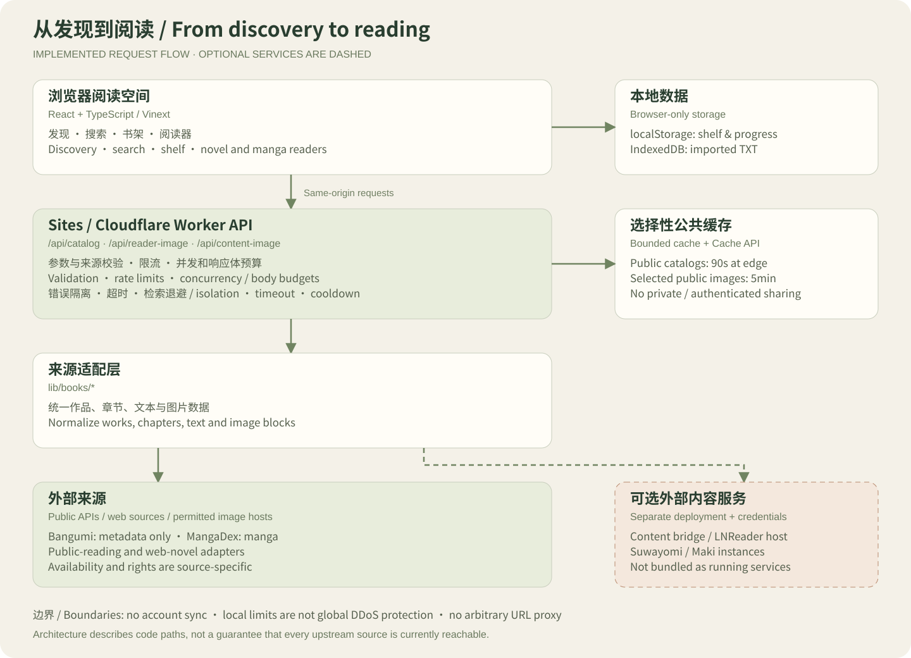

<p align="center"></p>

<h1 align="center">Lingqi Books · 零柒书境</h1>

<p align="center">From a line of prose to a panel of art. A quieter place to discover your next story.</p>
<p align="center"><a href="README.md">简体中文</a> · <strong>English</strong></p>
<p align="center"><a href="https://lingqi-books.tarokiki.chatgpt.site">Open the reading space</a> · <a href="#quick-start">Quick start</a> · <a href="#architecture">Architecture</a> · <a href="https://github.com/FlashPoint007/lingqi-books/issues">Report an issue</a></p>

---

## One shelf. Many stories.

Lingqi Books brings **discovery, source selection, a personal shelf and reading** into one browser interface. Paper-inspired colors, Chinese serif headings and a responsive layout keep the focus on stories on desktop and mobile.

This is not a licensed content library or a promise that every upstream is always available. **Metadata, adapter implementation, source enablement and successful reading are distinct states.** A reachable homepage or catalog does not prove that chapter text and images work.

| Discover | Collect | Read |
| :--- | :--- | :--- |
| Federated search, categories, filters and recommendations | Local shelf, history and JSON export | Online novels, manga and local TXT |
| One failed source does not discard other results | Stable source-qualified work IDs | Resume by chapter and in-chapter position |
| Bangumi metadata, ratings and match candidates | No silent merging of same-title works | Inline illustrations, zoom and image retry |

## The reading experience

- **Light novels:** searchable chapter lists, fixed chapter navigation and resumable reading; adjustable background, text color, font, size, line spacing and width. Supported rich-content adapters preserve inline illustrations.
- **Manga:** long-strip and paged modes, chapter navigation and image retries. MangaDex retains scanlation-group attribution and supports a data-saver image fallback.
- **Your own text:** import TXT files up to 15 MB or paste text, with UTF-8 / GB18030 detection and chapter splitting. Imported text stays in browser IndexedDB and is not uploaded.
- **Honest source status:** unconfigured, unavailable, unverified and cooling-down states are visible. Bangumi metadata is not presented as novel text.
- **Resilient discovery:** request deadlines, source isolation and search backoff; short-lived edge caching is restricted to eligible public catalogs and selected public images.

> The banner is original vector artwork, not a product screenshot. Features describe repository implementation; live source availability varies with time, region and deployment settings.

## Architecture



**The browser owns reading and personal data; the Worker mediates upstream access; optional external services host extension runtimes.**

1. The React / TypeScript UI calls same-origin catalog and image APIs.
2. The Worker validates inputs, sources and request budgets, routes to adapters, normalizes work/chapter/content data and isolates failures.
3. Bangumi, MangaDex, public-reading and web-novel adapters contact their permitted upstreams.
4. Content bridges, Suwayomi, Maki and LNReader hosts require separate configuration. **An adapter in the repository is not an already-running production service.**
5. Shelf and progress use localStorage; imported text uses IndexedDB. Accounts and cross-device synchronization are not implemented.

Dashed connections represent optional external services. Image endpoints are controlled fetch paths, not arbitrary URL proxies. Local caches and rate limits are not global DDoS protection.

<details>
<summary>Accessible text version of the data flow</summary>

- Browser → same-origin Worker API → source adapters → permitted upstreams.
- Browser ↔ localStorage / IndexedDB; local TXT does not pass through the server.
- Worker → bounded in-memory caches / selective Cache API edge caching.
- Worker → optional HTTPS content bridge or personal reader services; credentials stay server-side.
- External content becomes structured text/image blocks; upstream HTML and plugin scripts do not execute in the browser.

</details>

Implementation entry points: [catalog API](app/api/catalog/route.ts) · [content images](app/api/content-image/route.ts) · [bridge client](lib/books/bridge.ts) · [request protection](lib/books/read-protection.ts)

## Sources and boundaries

| Source / category | Repository capability and limitations |
| :--- | :--- |
| Bangumi | Metadata, ratings and match candidates, not novel bodies. Users choose matches; they are not silently persisted as authoritative mappings. |
| MangaDex | Simplified/traditional Chinese manga. English is a separately enabled source. Platform and group attribution is retained; availability depends on upstream chapters, limits and image access. |
| Public reading adapters | SFACG free chapters, official Honkai Impact 3 manga, N8, Komiic, MangaBz, Manhuagui, Linovel, DM5 and lnovel API, among others. Enablement requires configuration and full reading validation; VIP content stays locked. |
| Web-novel adapters | Wenku8, traditional-Chinese Bilinovel, ESJ and Masiro. Login, verification, hidden catalogs or obfuscated text can prevent access. |
| Kakuyomu / Narou | Kakuyomu previously returned production 403 and remains pending validation. Narou is disabled by default and supports Japanese discovery only, not body scraping; operator registration and terms checks are required. |
| Maki / Suwayomi / LNReader | Adapters and bridge code require external instances, trusted plugins, allowlists and end-to-end validation. They are not pre-provisioned content services. |
| Further licensed sources | Verify rights, maintainers, attribution and search → catalog → text/image evidence before onboarding. |

See [historical validation records](docs/validation.md). An old successful sample is not a guarantee of current availability: check source status and an actual chapter.

## Quick start

Requires **Node.js 22.13+** and **pnpm**. The pinned package-manager version is in [package.json](package.json).

```sh
pnpm install
pnpm dev
```

Validate and build:

```sh
pnpm test
pnpm typecheck
pnpm build
pnpm start
```

After building, `pnpm start` runs the local Worker production preview. The application uses React / TypeScript / Vinext and retains ChatGPT Sites build integration. For your own deployment, remove the original `project_id` from `.openai/hosting.json` and bind your own Site. Do not copy another deployment's identity or credentials.

## Configuration and operations

Use deployment environment variables, never credentials committed to Git or embedded in the browser:

| Variable | Purpose |
| :--- | :--- |
| `PUBLIC_READING_SOURCES` | Comma-separated source IDs. Enable a source only after production catalog, text and image validation. See the [catalog API](app/api/catalog/route.ts) for IDs and status logic. |
| `NAROU_ENABLED` | Disabled by default. Set to `true` only after operator registration and checks of purpose, non-commercial and content requirements. |
| `MANGADEX_BLOCKED_GROUPS` | Scanlation-group UUIDs blocked after removal requests. Redeploy after updating; both catalog and reading routes check the list. |
| `CONTENT_BRIDGE_URL` / `CONTENT_BRIDGE_TOKEN` | HTTPS URL and server-side credential for the optional content bridge. |
| `NOVEL_BRIDGE_SOURCE_*` | Route a particular novel source through a configured compatible content service. |

Redeploy after configuration changes. See [content services](docs/content-services.md) for external-service contracts and setup.

Implemented protections include instance-local rate limits, concurrency/body budgets, upstream deadlines and search cooldowns. Eligible public catalogs can use 90-second edge caching; selected public-interface images can use 5-minute caching. Chapter bodies, private services and authenticated data are excluded from this shared cache. **These are not strict cross-node global limits or evidence of an installed WAF.** Consult [stability and security operations](docs/operations-security.md) for exact scope and exceptions.

## Data and privacy

- Work identity is `source:id`, not its title. Same-title works, media types and volumes are not silently merged.
- Shelf, history and preferences remain in the current browser. Clearing site data removes records and imported text.
- Version 2 JSON backups can be merged through Restore backup on the shelf, preserving existing entries and newer progress. Backups exclude local TXT bodies and reading preferences. Account-based automatic cross-device sync is not implemented.
- Image requests are restricted to source catalogs or allowed image hosts; there is no open proxy.
- External material is rendered as text/image blocks, not executable upstream HTML or third-party plugin scripts.

## Documentation

| Guide | Contents |
| :--- | :--- |
| [Architecture and evolution](docs/architecture.md) | Design history, data model and future work; read early sections alongside the implementation updates |
| [Content services](docs/content-services.md) | Rich-content adapters, bridge contracts and configuration |
| [Stability and security](docs/operations-security.md) | Limits, caches, backoff and protection boundaries |
| [Validation log](docs/validation.md) | Historical samples, test outcomes and unverified items |

The linked engineering guides are currently in Chinese.

## Feedback, attribution and license

Open an [issue](https://github.com/FlashPoint007/lingqi-books/issues) with the source, work link, reproduction steps and sanitized error. **Do not post passwords, cookies, tokens or private reading data.** Removal requests should identify the rights holder or scanlation group and affected works.

MangaDex use respects its non-advertising, non-paid and attribution requirements and removal requests. Code is [MIT licensed](LICENSE); dependencies retain their own licenses. Metadata, covers, prose, translations and manga artwork **are not covered by the code license**. Operators must verify source terms and content rights.

<p align="center">One more chapter. A whole new world.<br><sub>故事的下一页，总有新的风景。</sub></p>
