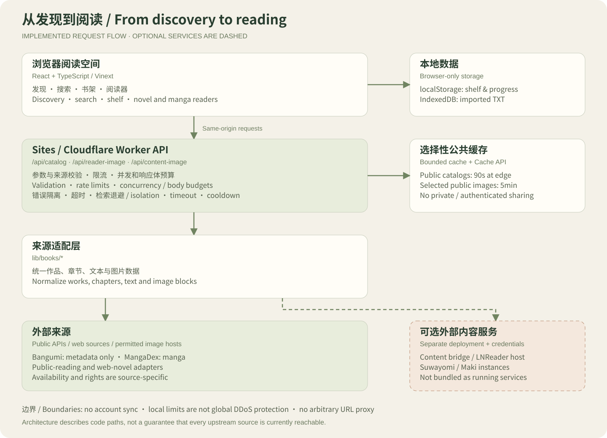

<p align="center"></p>

<h1 align="center">零柒书境 · Lingqi Books</h1>

<p align="center">从一段文字，到一格画面。一个安静、轻盈、以阅读为中心的空间。</p>
<p align="center"><strong>简体中文</strong> · <a href="README.en.md">English</a></p>
<p align="center"><a href="https://lingqi-books.tarokiki.chatgpt.site">打开阅读空间</a> · <a href="#快速开始">快速开始</a> · <a href="#系统架构">系统架构</a> · <a href="https://github.com/FlashPoint007/lingqi-books/issues">反馈问题</a></p>

---

## 一个书架，多种故事

零柒书境将轻小说与漫画的**发现、选源、书架和阅读**放在同一个浏览器界面中。纸感配色、中文衬线标题和响应式布局，让桌面与手机都能专注于故事本身。

它不是内容版权库，也不承诺每个来源始终可用：**作品资料、适配代码、来源启用和实际可读，是四件不同的事。** 首页、目录或搜索成功，不能代替正文与图片的完整验证。

| 发现故事 | 安心收藏 | 专注阅读 |
| :--- | :--- | :--- |
| 多源联合搜索、分类、筛选与推荐 | 本地书架、阅读历史与 JSON 导出 | 在线小说、漫画与本地 TXT |
| 单源故障不覆盖其他来源结果 | 按作品来源与稳定 ID 保存 | 章节续读、主题与排版自定义 |
| Bangumi 元数据、评分与匹配候选 | 不把同名作品自动合并 | 原位插图、放大和图片重试 |

## 阅读体验

- **轻小说**：目录检索、固定翻章栏、章节身份与章内位置续读；可调整背景、文字颜色、字体、字号、行距与正文宽度。适配的图文来源保留原位插图。
- **漫画**：条漫与逐页模式、目录跳转、固定翻页栏、切章、图片失败重试；MangaDex 保留汉化组署名并提供节流图片回退。
- **自己的文本**：导入不超过 15 MB 的 TXT，或粘贴文本；支持 UTF-8 / GB18030 检测与章节识别。正文保存在浏览器 IndexedDB，不上传服务器。
- **透明的来源状态**：显示未配置、不可达、待验证或冷却状态；Bangumi 只提供元数据，不冒充小说正文源。
- **更稳的检索**：请求超时、单源故障隔离与检索退避；只对符合条件的公开目录和部分公开图片使用短时边缘缓存。

> 横幅是本项目原创矢量插画，不是产品截图。功能说明来自仓库实现；线上来源的可达性会随时间、地区和配置变化。

## 系统架构



**浏览器负责阅读与个人数据，Worker 负责受控的数据访问，可选服务负责扩展运行时。**

1. React / TypeScript 界面请求同源目录与图片 API。
2. Worker 校验参数、来源与访问预算，然后路由到来源适配器；统一作品、章节和图文数据，隔离错误。
3. Bangumi、MangaDex、公开阅读接口和网页适配器访问各自允许的上游。
4. 可选内容桥接、Suwayomi、Maki 或 LNReader 宿主需要独立配置；**代码中有适配器，不代表已有可用生产实例**。
5. 书架与进度存于 localStorage，本地文本存于 IndexedDB。当前没有账户和跨设备同步。

图中的虚线表示可选外部服务。受控图片端点不是任意 URL 代理。缓存和限流含单实例边界，不能理解成全局 DDoS 防护。

<details>
<summary>文字版数据流（便于检索与无障碍阅读）</summary>

- 浏览器 → 同源 Worker API → 来源适配器 → 允许的外部来源。
- 浏览器 ↔ localStorage / IndexedDB；本地 TXT 不经过服务器。
- Worker → 有限内存缓存 / 选择性 Cache API 边缘缓存。
- Worker → 可选 HTTPS 内容桥接或个人阅读服务；凭据留在服务端。
- 来源返回结构化文本与图片块；不在浏览器执行来源 HTML 或插件脚本。

</details>

实现入口：[目录 API](app/api/catalog/route.ts) · [内容图片 API](app/api/content-image/route.ts) · [桥接客户端](lib/books/bridge.ts) · [阅读保护](lib/books/read-protection.ts)

## 来源与能力边界

| 来源 / 类别 | 仓库能力与注意事项 |
| :--- | :--- |
| Bangumi | 作品资料、评分和匹配候选；不提供小说正文。匹配需用户选择，不自动保存为权威映射。 |
| MangaDex | 简繁中文漫画；英文版独立选源、需启用。署名平台与汉化组，缺章、限流和图片可达性受源站影响。 |
| 公开小说 / 漫画适配 | SF 轻小说免费章节、崩坏 3 官方漫画、N8、Komiic、MangaBz、漫画柜、轻之文库、动漫屋及 lnovel API 等；是否启用取决于配置与完整阅读验证，VIP 内容保持锁定。 |
| 网页小说适配 | 轻小说文库、哔哩繁体、ESJ、真白萌；登录、验证、隐藏目录和混淆正文可能限制读取。 |
| Kakuyomu / 小説家になろう | Kakuyomu 适配曾遇生产 403，保持待验证；Narou 默认关闭，仅日文作品发现，不抓取正文，启用前需核对注册和使用条件。 |
| Maki / Suwayomi / LNReader | 适配或桥接代码不等于现成内容服务；需要外部实例、可信插件、允许列表及端到端验收。 |
| 其他授权来源 | 逐项确认授权范围、维护者、署名与搜索 → 目录 → 正文 / 图片测试证据，再接入。 |

历史样本检查见 [验证记录](docs/validation.md)。不要把旧的成功记录当作当前可用性保证；以站内来源状态与实际章节读取为准。

## 快速开始

需要 **Node.js 22.13+** 和 **pnpm**；具体 pnpm 版本见 [package.json](package.json)。

```sh
pnpm install
pnpm dev
```

检查并构建：

```sh
pnpm test
pnpm typecheck
pnpm build
pnpm start
```

`pnpm start` 在构建后运行本地 Worker 生产预览。项目采用 React / TypeScript / Vinext，保留 ChatGPT Sites 构建集成；复制部署时，应移除 `.openai/hosting.json` 中原有 `project_id`，绑定你自己的 Site。不要复制他人的部署标识或凭据。

## 配置与运维

通过部署环境变量配置，不把密钥写入 README、前端或 Git：

| 变量 | 用途 |
| :--- | :--- |
| `PUBLIC_READING_SOURCES` | 逗号分隔的来源 ID；只启用逐项通过生产完整阅读验证的来源。可用 ID 与当前判断见 [目录 API](app/api/catalog/route.ts)。 |
| `NAROU_ENABLED` | 默认关闭；完成运营者注册及用途、非商业与内容规则核对后才设置为 `true`。 |
| `MANGADEX_BLOCKED_GROUPS` | 需屏蔽的汉化组 UUID；处理移除申请后更新并重新部署，目录与阅读接口均检查。 |
| `CONTENT_BRIDGE_URL` / `CONTENT_BRIDGE_TOKEN` | 可选内容桥接服务的 HTTPS 地址与服务端凭据。 |
| `NOVEL_BRIDGE_SOURCE_*` | 将特定小说来源路由到已配置的兼容内容服务。 |

配置变更后重新部署。外部服务详细契约及配置见 [内容服务说明](docs/content-services.md)。

目前实现了单实例限流、并发与响应大小预算、来源请求超时和检索冷却；公开目录可使用 90 秒边缘缓存，指定公开接口图片可使用 5 分钟缓存。正文、私人服务及认证数据不进入该共享缓存。**这些机制不是跨节点严格全局限流，也不等于已配置 WAF。** 具体范围、例外与运维建议以 [阅读稳定性与安全运维](docs/operations-security.md) 为准。

## 数据与隐私

- 作品使用 `source:id`，不用标题作为主键；同名作品、类型与分卷不静默合并。
- 书架、历史和偏好保存在当前浏览器；清除站点数据会丢失记录及导入文本。
- 版本 2 JSON 备份可在书架的“恢复备份”入口合并恢复收藏、历史与进度，不清空现有数据，并保留较新的进度。备份不含本地 TXT 正文或阅读设置；没有账户和自动跨设备同步。
- 图片请求仅接受来源目录或允许图床，保留来源校验；不提供任意目标代理。
- 外部内容以文本 / 图片块渲染，不执行来源 HTML 或第三方插件脚本。

## 文档导航

| 文档 | 内容 |
| :--- | :--- |
| [架构与演进](docs/architecture.md) | 设计背景、数据模型与后续方向；早期段落需结合文末实现更新阅读 |
| [内容服务](docs/content-services.md) | 图文适配、桥接契约与服务配置 |
| [稳定性与安全](docs/operations-security.md) | 限流、缓存、故障退避和防护边界 |
| [验证记录](docs/validation.md) | 历史样本、测试结果及未验证事项 |

## 反馈、署名与许可

通过 [Issues](https://github.com/FlashPoint007/lingqi-books/issues) 提交来源、作品链接、复现步骤与脱敏错误。**不要提交密码、Cookie、Token 或私人阅读数据。** 内容移除申请请提供可核对的权利人 / 汉化组身份及作品范围。

MangaDex 使用遵守非广告、非付费与署名要求，并尊重移除请求。代码使用 [MIT](LICENSE) 许可；第三方依赖保留各自许可。作品元数据、封面、正文、翻译和漫画图片**不属于代码开源许可范围**，使用者仍需核对来源条款与内容权利。

<p align="center">故事的下一页，总有新的风景。<br><sub>One more chapter. A whole new world.</sub></p>
